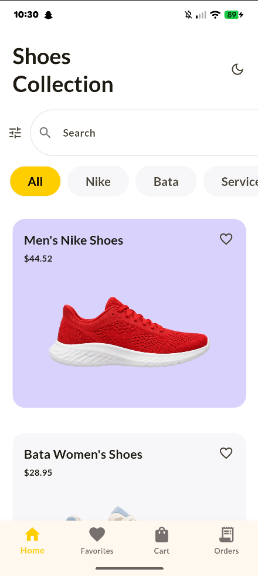
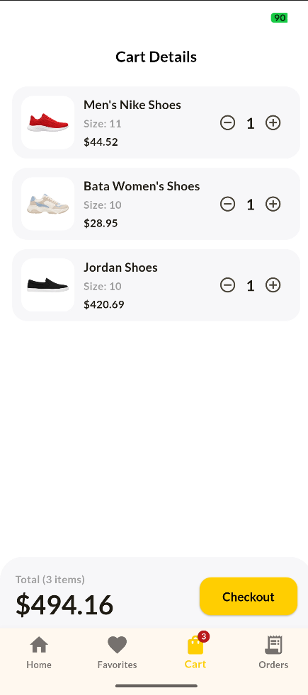
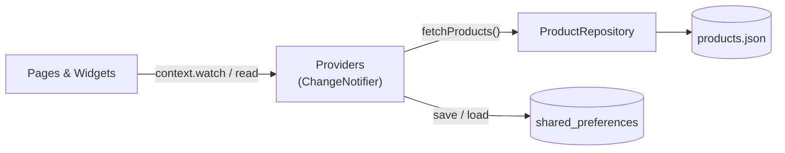

<div align="center">

# 👟 ShoeHub

**A shoe shopping app built with Flutter and Provider.**

Browse shoes, filter by brand, pick your size, and check out. Your cart,
favorites, orders and theme are saved on the device.

[](https://github.com/RafayAijaz/Shopping-App/actions/workflows/ci.yml)


**[▶ Try the live demo](https://rafayaijaz.github.io/Shopping-App/)**

</div>

<!--
  SCREENSHOTS: run the app, take screenshots, save them in docs/screenshots/
  with these names, then delete this comment line and the one after the table.

| Home | Product | Cart | Checkout | Orders | Dark mode |
|:---:|:---:|:---:|:---:|:---:|:---:|
|  |  |  |  |  |  |
-->

## ✨ Features

**Shopping**
- Product catalog with **search** (by name or brand) and **brand filter chips**
- **Sorting** by price or name
- Product page with **size picker** and a **Hero** image animation
- **Favorites** with a heart on every product

**Cart & checkout**
- Cart with **quantities**, live **subtotal**, and a **badge** on the cart tab
- **Swipe to delete** with **Undo**
- **Free delivery** over $100, with a "spend $X more" hint
- **Checkout form with validation** (name, phone, address, city) and payment method
- **Order confirmation** screen and full **order history**

**Quality**
- **Saved on the device:** cart, favorites, orders and theme survive an app restart
- **Loading, error + retry, and empty states** on every screen
- **Light and dark mode**, following the system setting or a manual toggle
- **Responsive:** one column on phones, a 2–3 column grid on tablets and web
- **21 automated tests** (unit and widget) running on every push

## 🛠 Tech stack

| | |
|---|---|
| Framework | Flutter (Material 3) |
| State management | [provider](https://pub.dev/packages/provider) |
| Local storage | [shared_preferences](https://pub.dev/packages/shared_preferences) |
| Testing | flutter_test (unit + widget tests) |
| CI/CD | GitHub Actions: analyze + test on every push, web demo deployed to GitHub Pages |

## 🏗 Architecture



- **Pages and widgets** only display data and react to taps.
- **Providers** hold the app state (products, cart, favorites, orders, theme) and notify the UI when it changes.
- **`ProductRepository`** is the only class that knows where products come from. It reads a bundled JSON file today; switching to a real REST API means changing this one class. The UI and providers stay the same.
- Tests use a `FakeProductRepository`, so they're fast and don't depend on files or the network.

```
lib/
├── main.dart                 # providers + MaterialApp
├── data/
│   └── product_repository.dart
├── model/                    # Product, CartItem, Order (+ JSON)
├── providers/                # Product, Cart, Favorites, Orders, Theme
├── pages/                    # Home, Details, Cart, Checkout, Success, Orders, Favorites
├── widgets/                  # ProductList, ProductGrid, ProductCard, CartItemTile, EmptyState
├── theme/app_theme.dart      # light + dark themes, app colors
└── utils/date_format.dart
```

## 🚀 Getting started

```bash
git clone https://github.com/RafayAijaz/Shopping-App.git
cd Shopping-App
flutter pub get
flutter run
```

Run the tests:

```bash
flutter test
```

## 💡 What I learned

- **Typed models instead of Maps.** The app started with `Map<String, dynamic>` products. Moving to `Product` / `CartItem` classes turned runtime crashes (a wrong key or a bad cast) into compile errors.
- **Compare by id, not by object.** The cart merges "same product, same size" by comparing ids, so it keeps working when products are re-created from JSON.
- **Decimal math isn't exact.** `44.52 * 2` isn't exactly `89.04` in floating point, so the tests use `closeTo`. A production app would store prices in cents as integers.
- **Tests find real bugs.** The widget tests caught a checkout form that skipped validating fields scrolled off screen (a `ListView` doesn't build them), and an empty state that overflowed on short screens.
- **The repository pattern pays off.** Swapping the real data source for a fake one in tests took one constructor parameter.

## 🔮 Future improvements

- Load products from a REST API or Firebase
- User accounts (sign up / log in) with a cart synced across devices
- Online payments
- Product reviews and ratings
