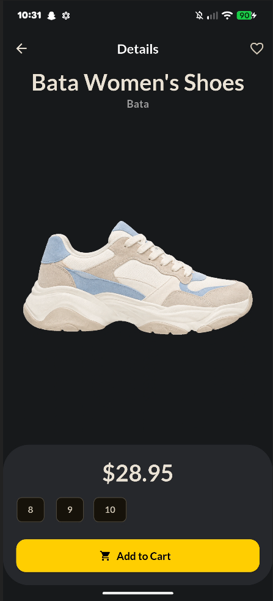
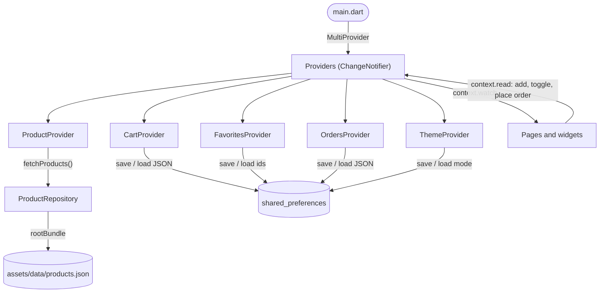
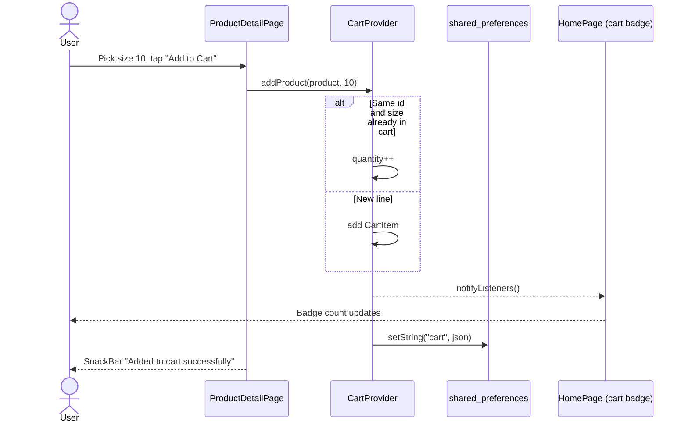

<div align="center">



<br><br>


# ShoeHub

**Browse shoes, pick your size, and check out. Your cart survives an app restart.**

A complete shoe store in Flutter: search, brand filters, sorting, favorites, a cart with quantities,<br>
a validated checkout and order history. It's built with Provider, typed models, a repository layer and 22 automated tests.

<br>


[](https://rafayaijaz.github.io/Shopping-App/)
[](https://github.com/RafayAijaz/Shopping-App/actions/workflows/ci.yml)


### [▶ Try the live demo in your browser](https://rafayaijaz.github.io/Shopping-App/)

[Features](#-features) · [Preview](#-preview) · [How it works](#-how-it-works) · [Tech stack](#-tech-stack) · [Getting started](#-getting-started) · [Tests](#-tests) · [Structure](#-project-structure) · [Roadmap](#-roadmap)

</div>

---

## ✨ Features

<table>
<tr>
<td width="50%" valign="top">

### 🔎 Find the right pair
- **Search** by name or brand
- **Brand filter chips**, built from the catalog itself
- **Sort** by price (low/high) or name, with a dot when a sort is active
- **Pull to refresh** the catalog

</td>
<td width="50%" valign="top">

### 👟 Product page
- **Size picker** using the sizes each product actually has
- **Hero** image animation from the list to the details
- **Favorite** with a heart on every card and on the details page
- Friendly SnackBar if you forget to pick a size

</td>
</tr>
<tr>
<td width="50%" valign="top">

### 🛒 Cart and checkout
- **Quantities** with +/−, and a cart **badge** on the tab bar
- Same product + same size **merges** into one line
- **Swipe to delete** with **Undo**
- **Free delivery** from $100, with an "add $X more" hint
- **Validated checkout form** (name, phone, address, city), Cash on Delivery

</td>
<td width="50%" valign="top">

### 💾 Built to last
- Cart, favorites, orders and theme **saved on the device**
- **Order confirmation** screen and full **order history**
- **Loading and error + retry** on the catalog, **friendly empty states** for search, favorites, cart and orders
- **Light and dark mode**: follows the system or a manual toggle
- **Responsive grid**: 1 column on phones, up to 3 on wide screens and the web
- **Animated splash screen**, with matching native launch screens on Android and iOS

</td>
</tr>
</table>

## 📱 Preview

<div align="center">

| Home | Product details (dark mode) | Cart |
|:---:|:---:|:---:|
|  |  |  |

<sub>Real screenshots from the running app.</sub>

</div>

<!-- DEMO GIF: save a short recording as docs/screenshots/demo.gif, then uncomment:
<p align="center"></p>
-->

## 🧠 How it works

### Architecture



- **Pages and widgets** only show data and react to taps.
- **Providers** hold the state (products, cart, favorites, orders, theme) and tell the UI when it changes.
- **`ProductRepository`** is the only class that knows *where* products come from. Today that's a bundled JSON file. Switching to a REST API means changing this one class.

### What happens when you tap "Add to Cart"



### Engineering decisions

| Decision | Why it matters |
|---|---|
| **Typed models** (`Product`, `CartItem`, `Order`) with `fromJson` / `toJson` | The app started with `Map<String, dynamic>`. Typed classes turn a wrong key or a bad cast from a runtime crash into a compile error. |
| **Repository pattern** for products | Tests swap in a `FakeProductRepository` through one constructor parameter, so they run fast without files or a network. |
| **Compare cart lines by id + size**, not by object | Products are re-created from JSON on every launch, so object equality would break merging after a restart. |
| **Orders copy their cart items** | Changing the cart after checkout can't change an order that was already placed (there's a test for it). |
| **`SingleChildScrollView` for the checkout form** instead of `ListView` | A `ListView` doesn't build fields that are off screen, so they were never validated. A widget test caught this. |
| **`IndexedStack` for the tabs** | Each tab keeps its scroll position and search text when you switch away and back. |
| **Unique Hero tags per screen** (`home-1`, `favorites-1`) | The same product can be on two tabs at once. Duplicate Hero tags would crash the animation. |

## 🛠 Tech stack

| Layer | Choice |
|---|---|
| Framework | [Flutter](https://flutter.dev) (Material 3) with the Lato font |
| Language | [Dart 3](https://dart.dev) |
| State management | [provider](https://pub.dev/packages/provider) |
| Local storage | [shared_preferences](https://pub.dev/packages/shared_preferences) |
| Linting | [flutter_lints](https://pub.dev/packages/flutter_lints) |
| Testing | `flutter_test` (unit + widget) |
| CI/CD | GitHub Actions: `flutter analyze` + `flutter test` on every push; the web build is deployed to [GitHub Pages](https://rafayaijaz.github.io/Shopping-App/) |

## 🚀 Getting started

**Just want to look?** Open the [live demo](https://rafayaijaz.github.io/Shopping-App/), no install needed.

**Prerequisites:** the [Flutter SDK](https://docs.flutter.dev/get-started/install) (stable channel, Dart 3.12+), plus an emulator, a device or Chrome.

```bash
git clone https://github.com/RafayAijaz/Shopping-App.git
cd Shopping-App
flutter pub get
flutter run            # or: flutter run -d chrome
```

No API keys or `.env` file are needed. Products come from `assets/data/products.json`.

> [!TIP]
> If `flutter pub get` complains about the SDK version, run `flutter upgrade`. This project needs Dart 3.12 or newer.
> To start fresh (empty cart, no orders), clear the app's data or uninstall it. Everything is stored with `shared_preferences`.

## 🧪 Tests

```bash
flutter test
```

| File | What it checks |
|---|---|
| `test/cart_provider_test.dart` (8) | Same product + size merges, different sizes stay separate, subtotal × quantity, delivery fee under/over $100, −1 at quantity 1 removes, Undo puts an item back in place, clear, and save/load after a restart |
| `test/providers_test.dart` (7) | `Product` JSON round-trip, whole-number prices become doubles, new orders go on top, placed orders don't change with the cart, orders and favorites survive a restart |
| `test/widget_test.dart` (7) | Splash shows the logo and title then opens Home, error state with Retry, the product list, the brand filter, search, the no-results state, and the **full flow**: add to cart → checkout → see the order |

## 📂 Project structure

```
lib/
├── main.dart                     # MultiProvider + MaterialApp, starts on the splash
├── data/
│   └── product_repository.dart   # the only place that knows where products come from
├── model/
│   ├── product.dart              # Product + JSON
│   ├── cart_item.dart            # product, size, quantity
│   └── order.dart                # items, totals, shipping details, date
├── providers/
│   ├── product_provider.dart     # loading / error / products
│   ├── cart_provider.dart        # quantities, subtotal, delivery fee, saved cart
│   ├── favorites_provider.dart   # Set of favorite ids, saved
│   ├── orders_provider.dart      # place order, saved order history
│   └── theme_provider.dart       # system / light / dark, saved
├── pages/
│   ├── splash_page.dart          # animated logo + title, then Home
│   ├── home_page.dart            # bottom navigation + cart badge
│   ├── product_detail_page.dart  # size picker, Hero image, add to cart
│   ├── favorites_page.dart       # favorite products grid
│   ├── cart_page.dart            # swipe to delete + Undo, total bar
│   ├── checkout_page.dart        # validated form, payment method, summary
│   ├── order_success_page.dart   # confirmation
│   └── orders_page.dart          # expandable order history
├── widgets/
│   ├── product_list.dart         # search, filter chips, sort sheet
│   ├── product_grid.dart         # responsive 1–3 column grid
│   ├── product_card.dart         # card with heart button
│   ├── cart_item_tile.dart       # +/− quantity, confirm on remove
│   └── empty_state.dart          # reusable empty / error view
├── theme/app_theme.dart          # colors + Material 3 light/dark themes
└── utils/date_format.dart        # "21 Nov 2026, 3:05 PM"
assets/
├── data/products.json            # the catalog
├── images/                       # product photos + logo
└── fonts/                        # Lato
test/                             # 22 unit + widget tests
.github/workflows/                # ci.yml, deploy-web.yml
```

## 🗺 Roadmap

- [x] Typed models, repository layer, saved state
- [x] Cart quantities, checkout, orders, favorites, sorting, dark mode
- [x] 22 unit and widget tests
- [x] App icons and an animated splash screen
- [x] Web demo deployed to GitHub Pages on every push
- [ ] Get CI green (`flutter analyze` + `flutter test`)
- [ ] Store prices as integer cents (floating-point money needs `closeTo` in tests today)
- [ ] Load products from a REST API or Firebase (only `ProductRepository` changes)
- [ ] User accounts, with the cart synced across devices
- [ ] Online card payments through a provider SDK, with keys and order totals checked on a server, never trusted from the app
- [ ] Product reviews and ratings

## 📜 Commit history

Built step by step, one feature per commit:

```
02ece63  add bottom navigation bar
b4ee066  add cart provider
e5ce36f  Add snackbars and cart features
b30254b  add search feature
72edee6  Refactor into folders and typed models
2a6b48d  Add JSON models, product repository and saved state with shared_preferences
15e5a2b  Add cart quantities, checkout, orders, favorites, sorting and dark mode
d27132d  Add unit and widget tests
120880b  Rename app to ShoeHub, add README and GitHub Actions workflows
1bb90d5  Add ShoeHub app icons for Android and web
eb61e5a  Update web icons and favicon
79feef5  Add README banner and UI preview artwork
ab4fbeb  Rewrite README with visuals, diagrams and test overview
343a7f9  Add splash screen with logo and app title
48151fd  Add splash screen
4dcedfa  Stop tracking Kotlin session files
d051588  Add app screenshots
```

## 🙏 Acknowledgements

- [Flutter](https://flutter.dev) and the [provider](https://pub.dev/packages/provider) and [shared_preferences](https://pub.dev/packages/shared_preferences) packages
- The [Lato](https://fonts.google.com/specimen/Lato) font family
- Badges by [shields.io](https://shields.io)

---

<div align="center">

### 👨‍💻 Author

**Muhammad Rafay Aijaz**: Flutter developer and cybersecurity student

[](https://github.com/RafayAijaz)

If this project helped you or you liked it, please give it a ⭐

</div>
